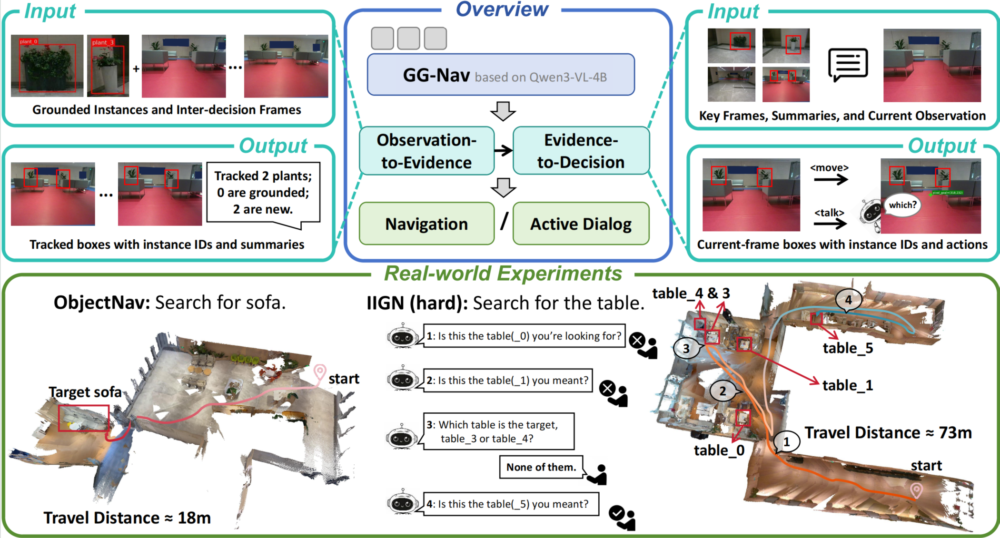

# GG-Nav

GG-Nav is a navigation framework that learns structured chain-of-thought (CoT) reasoning through supervised fine-tuning to better use streaming observations and precisely localize navigation targets to support action generation. It is the first model to jointly support interactive instance-goal navigation and ObjectNav. Its reasoning consists of two stages: **Observation-to-Evidence**, which extracts goal-relevant evidence from intermediate frames between adjacent decision steps, and **Evidence-to-Decision**, which combines the current observation with accumulated evidence to ground the target and generate navigation actions or clarification questions. GG-Nav improves success rates over state-of-the-art methods on HM3D ObjectNav, VL-LN, and CoIN by 3.1%, 16.6%, and 5.3%, respectively, and demonstrates zero-shot generalization on a Unitree Go2 robot in unseen real-world environments.

- **ObjectNav:** Navigate to an instance of a specified object category, evaluated on HM3D ObjectNav.
- **interactive instance-goal navigation:** Navigate to a target instance while asking clarification questions to resolve ambiguity, evaluated on VL-LN and CoIN.

## TODO

- [x] Release evaluation code.
- [x] Release model weights.
- [ ] Release training code.

## Installation

Run the following commands from the repository root (`ggnav/`):

```bash
conda create -n ggnav python=3.9 -y
conda activate ggnav

conda install habitat-sim=0.2.4 withbullet headless -c conda-forge -c aihabitat
pip install -r requirements.txt
```

The release supports `shortest_path` evaluation. The required question-matching utility is bundled at `evaluation/tasks/pair_question.py`; the `Qwen3-VL/` source tree and training code are not required. The PyTorch packages in `requirements.txt` target PyTorch 2.6.0 with CUDA 12.4.

## Data Preparation

### 1. Download Data & Assets

- **Scene Datasets:** Download the [MP3D](https://niessner.github.io/Matterport/) scene dataset to `data/scene_data/mp3d/` and the [HM3D v0.2](https://aihabitat.org/datasets/hm3d/) scene dataset to `data/scene_data/hm3d_v0.2/`. Follow the linked download instructions to obtain the Habitat scene assets.
- **Scene Summaries:** Download the [MP3D scene summaries](https://huggingface.co/datasets/InternRobotics/VL-LN-Bench/tree/main/raw_data/mp3d/scene_summary) to `data/scene_summary/`.
- **HM3D ObjectNav Data:** Follow the [Habitat-Lab dataset download instructions](https://github.com/facebookresearch/habitat-lab/blob/main/DATASETS.md) for HM3D ObjectNav v2 and extract the dataset to `data/datasets/objectnav_hm3d_v2/`.
- **CoIN Data:** Download [CoIN-Bench](https://huggingface.co/datasets/ftaioli/CoIN-Bench/tree/main) and place the evaluation dataset under `data/datasets/coin/`.
- **VL-LN Data:** Download the [VL-LN MP3D data](https://huggingface.co/datasets/InternRobotics/VL-LN-Bench/tree/main/raw_data/mp3d) and place the evaluation dataset under `data/datasets/vlln/`.

### 2. Directory Structure

Prepare scene assets and evaluation datasets under `data/`:

```text
ggnav/
├── evaluation/
├── train/                       # Planned; not included in the current release
├── checkpoints/                # Model
├── requirements.txt
└── data/
    ├── scene_data/
    │   ├── mp3d/
    │   └── hm3d_v0.2/
    ├── scene_summary/           # Scene descriptions for interactive navigation
    └── datasets/
        ├── objectnav_hm3d_v2/
        ├── coin/
        └── vlln/
```

The task YAML files under `evaluation/config/` use `../data/scene_data/` and `../data/datasets/`, relative to `evaluation/`. Copy or link your evaluation datasets and scene summaries into the directories above.

## Evaluation

The launch scripts automatically switch to `evaluation/` and save results under `output/`. Place model files under `checkpoints/` using the checkpoint names in the scripts, or set `MODEL_PATH` to an absolute path before running. The model and processor are loaded from the same checkpoint directory. The local scripts activate the `ggnav` Conda environment. Configure the NPC API endpoint and fill in `evaluation/api_key.txt`; scene summaries are read from `data/scene_summary/`. The current entrypoint initializes the NPC client for both task families, so provide its API settings for ObjectNav as well.

```bash
conda activate ggnav
cd evaluation
```

### Single GPU / Debug

Use the local scripts with `--nproc_per_node=1`. For a short debug run, reduce `TURN` in the script.

```bash
# HM3D ObjectNav (the local script currently uses one GPU)
bash run_eval_objectnav_local.sh

# VL-LN (the local script currently uses one GPU)
bash run_eval_vlln_local.sh
```

### Multiple GPUs

Both local scripts use one GPU by default. Set `--nproc_per_node` in either local script to the number of GPUs to use, then run the same command.

For a Slurm cluster, adjust the resource and network settings in the corresponding scripts:

```bash
# HM3D ObjectNav
bash srun_eval_objectnav.sh

# VL-LN
bash srun_eval_vlln.sh

# CoIN
bash srun_eval_coin.sh
```

## Citation and Acknowledgments

If you find GG-Nav useful in your research, please cite our paper.

**TODO:** Add the paper link and BibTeX citation.

We thank the developers of Qwen3-VL, Habitat, and VLFM, as well as the creators of the HM3D, Matterport3D, VL-LN, and CoIN datasets and benchmarks.
